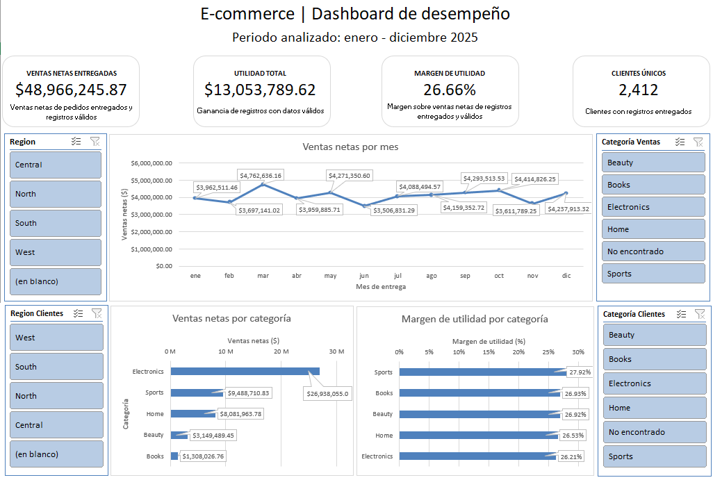

# Ecommerce Sales Analysis - Excel

Análisis de datos de un negocio de comercio electrónico realizado en Microsoft Excel, con el objetivo de evaluar el desempeño de las ventas, la rentabilidad y el comportamiento de los clientes.

El proyecto incluye procesos de limpieza y validación de datos, transformación, creación de métricas, tablas dinámicas y desarrollo de un dashboard interactivo para apoyar el análisis y la toma de decisiones basada en datos.

## Resumen del proyecto

- 10,000 registros analizados
- 14 variables originales
- Análisis de ventas, utilidad y margen
- Análisis por categoría, región y periodo
- Análisis de recurrencia de clientes
- Dashboard interactivo con segmentadores
- Identificación y tratamiento de problemas de calidad de datos

## Objetivo

Evaluar el desempeño de un negocio de comercio electrónico mediante técnicas de limpieza, transformación y análisis de datos en Excel, con el propósito de identificar patrones de ventas, rentabilidad y comportamiento de los clientes.

El análisis busca responder preguntas como:

- ¿Cuál es el desempeño general de las ventas y la utilidad?
- ¿Qué categorías generan mayores ventas y cuáles presentan mejores márgenes?
- ¿Cómo varían las ventas a lo largo del año?
- ¿Qué comportamiento presentan los clientes en términos de frecuencia de compra?
- ¿Qué problemas de calidad existen en los datos y cómo pueden afectar el análisis?

## Dataset

El proyecto utiliza un conjunto de datos de comercio electrónico compuesto por 10,000 registros y 14 variables originales, relacionadas con pedidos, clientes, productos, ventas, costos, entregas y satisfacción.

### Variables principales
- **Order_ID:** Identificador del pedido
- **Order_Date:** Fecha y hora del pedido
- **Customer_ID:** Identificador del cliente
- **Product:** Producto adquirido
- **Category:** Categoría del producto
- **Region:** Región
- **Quantity:** Cantidad de unidades
- **Unit_Price:** Precio unitario
- **Discount:** Descuento aplicado
- **Cost:** Costo unitario
- **Payment_Method:** Método de pago
- **Order_Status:** Estado del pedido
- **Delivery_Date:** Fecha de entrega
- **Satisfaction:** Nivel de satisfacción

Además, se generaron variables derivadas para facilitar el análisis, entre ellas:
- Category_Clean
- Net_Sales
- Profit
- Profit_Analysis_Status

## Limpieza y preparación de los datos

Antes de realizar el análisis se llevó a cabo un proceso de validación y preparación para identificar inconsistencias que pudieran afectar los resultados.

Entre las principales revisiones realizadas se encuentran:

- Identificación de valores faltantes
- Validación de cantidades y descuentos
- Revisión de costos y precios
- Validación de fechas de pedido y entrega
- Revisión de valores de satisfacción fuera de rango
- Identificación de Order_ID repetidos
- Recuperación de categorías faltantes mediante una tabla de correspondencia y BUSCARX
- Creación de variables calculadas para ventas netas y utilidad
- Clasificación de registros mediante Profit_Analysis_Status

Los registros con problemas de calidad no fueron eliminados automáticamente. Dependiendo de la variable afectada, fueron corregidos cuando fue posible o excluidos únicamente de las métricas que podían verse afectadas.

### Criterios para el análisis de rentabilidad

Para mantener consistencia entre las métricas financieras, las ventas netas, utilidad y margen de utilidad utilizados en el dashboard se consideran únicamente:

- Pedidos con Order_Status = "Delivered"
- Registros con Profit_Analysis_Status = "Válido"

La utilidad se calculó mediante:

**Profit = Net_Sales - (Cost x Quantity)**

y el margen de utilidad mediante:

**Margen = Profit / **Net_Sales**

Los registros que no cumplen estos criterios se conservan en la base de datos, pero no participan en las métricas financieras que requieren información completa y válida.

## Análisis y métricas

El análisis se estructuró en diferentes niveles para evaluar el desempeño comercial, la rentabilidad y el comportamiento de los clientes.

### Indicadores financieros

Se desarrollaron las siguientes métricas principales:

- **Ventas netas:** valor de las ventas después de aplicar los descuentos
- **Utilidad:** diferencia entre las ventas netas y el costo asociado a las unidades vendidas
- **Margen de utilidad:** proporción de la utilidad respecto a las ventas netas

Las fórmulas utilizadas fueron:

**Net_Sales = Quantity x Unit_Price x (1 - Discount)**

**Profit = Net_Sales - (Cost x Quantity)**

**Margen = Profit / Net_Sales**

Para mantener consistencia entre los indicadores financieros del dashboard, las métricas de ventas netas, utilidad y margen se calcularon sobre pedidos entregados cuyos registros cumplen los criterios definidos en Profit_Analysis_Status = "Válido".

### Análisis comercial

Se analizaron las ventas desde diferentes perspectivas:

- Evolución mensual de las ventas
- Ventas por categoría
- Desempeño de productos
- Comparación entre ventas, utilidad y margen
- Identificación de categorías y productos con diferentes niveles de rentabilidad

Para el análisis comercial también se conservaron registros que no podían participar en determinadas métricas financieras, siempre que la información disponible permitiera realizar el análisis correspondiente.

### Análisis de clientes

Se analizaron **2,412 clientes** identificados con pedidos entregados, utilizando el recuento distinto de Order_ID por Customer_ID para medir la frecuencia de compra.

Esto permite distinguir entre:

- Clientes con un solo pedido
- Clientes con más de un pedido

El uso de recuento distinto de Order_ID evita contabilizar varias filas de un mismo pedido como compras independientes cuando un pedido contiene diferentes productos.

### Herramientas de análisis

El análisis se realizó utilizando principalmente:

- **Excel:** limpieza, transformación y validación de datos
- **Tablas dinámicas:** agregación y exploración de información
- **Segmentadores:** filtrado interactivo por región y categoría
- **Dashboard:** visualización de KPIs, tendencias y resultados

## Dashboard

El dashboard presenta los principales indicadores de desempeño del negocio mediante KPIs, tablas dinámicas y gráficos interactivos.

Incluye cuatro segmentadores que permiten analizar la información desde diferentes perspectivas:

- **Región Ventas:** permite filtrar los indicadores y gráficos relacionados con las ventas según la región.
- **Categoría Ventas:** permite analizar el desempeño de las ventas según la categoría de producto.
- **Región Clientes:** permite analizar la distribución de clientes según la región.
- **Categoría Clientes:** permite analizar la distribución de clientes según la categoría de producto.

Además, el dashboard permite visualizar la evolución mensual de las ventas y analizar indicadores de rentabilidad y comportamiento de los clientes.

## Hallazgos principales

A partir del análisis realizado se identificaron los siguientes hallazgos:

### 1. Desempeño general

Durante el periodo analizado se obtuvieron:

- **Ventas netas:** $48,966,245.87
- **Utilidad:** $13,053,789.62
- **Margen de utilidad:** 26.66%

Esto significa que, considerando los costos registrados y los criterios de validación utilizados, aproximadamente $26.66 de cada $100 de ventas se convierten en utilidad.

### 2. Electronics concentra las ventas, pero presenta el menor margen

Electronics fue la categoría con mayor participación en ventas:

| Categoría | Ventas netas | Utilidad | Margen |
|---|---:|---:|---:|
| Electronics | $26,938,055.04 | $7,060,310.58 | 26.21% |
| Sports | $9,488,710.83 | $2,649,667.73 | 27.92% |
| Home | $8,081,963.78 | $2,143,774.16 | 26.53% |
| Beauty | $3,149,489.45 | $847,842.30 | 26.92% |
| Books | $1,308,026.76 | $352,194.84 | 26.93% |

Electronics genera la mayor utilidad absoluta debido a su volumen de ventas, pero presenta el margen más bajo entre las categorías analizadas.

### 3. Variación de las ventas durante el año

La mayor venta mensual se registró en **marzo**, con **$4,762,636.16**, mientras que **junio** presentó el menor nivel, con **$3,506,831.29**.

La diferencia entre ambos fue de: **$1,255,804.87**.

Los resultados muestran variaciones mensuales, pero el periodo disponible corresponde únicamente a un año, por lo que no es suficiente para confirmar la existencia de una tendencia sostenida o un patrón de estacionalidad.

### 4. Alta recurrencia en clientes

Se identificaron 2,412 clientes con órdenes entregadas.

De ellos:

- 2,073 clientes **(85.95%)** realizaron más de una orden distinta.
- 339 clientes **(14.05%)** realizaron únicamente una orden.

Para evitar sobreestimar la frecuencia de compra, la recurrencia se calculó utilizando el número de Order_ID distintos por cliente, considerando únicamente órdenes entregadas.

## Recomendaciones

A partir de los hallazgos obtenidos se proponen las siguientes acciones:

- **Monitorear periódicamente** ventas, utilidad y margen para identificar cambios en el desempeño comercial.
- **Analizar la rentabilidad de Electronics**, revisando factores como precios, costos y descuentos para determinar oportunidades de mejora en el margen.
- **Investigar las variaciones mensuales de ventas**, relacionándolas con descuentos, volumen de órdenes, categorías, productos y disponibilidad de inventario.
- **Fortalecer las estrategias de fidelización**, especialmente para los clientes que realizaron una sola compra, con el objetivo de incentivar una segunda compra.
- **Mantener controles de calidad de datos**, especialmente sobre precios, costos, descuentos, cantidades, fechas y datos de clientes.

## Limitaciones

El análisis presenta las siguientes limitaciones:

- El dataset contiene información correspondiente a un solo periodo anual, por lo que no permite confirmar patrones de estacionalidad o tendencias de largo plazo.
- El 85.95% de clientes recurrentes representa recurrencia dentro del periodo analizado y no debe interpretarse como una tasa de retención de largo plazo.
- Existen registros con información incompleta en variables como Customer_ID, Product, Cost, Discount y Satisfaction.
- Las métricas financieras del dashboard utilizan únicamente órdenes **Delivered** con Profit_Analysis_Status = "Válido".
- No se cuenta con variables adicionales como inversión publicitaria, promociones externas, inventario detallado, devoluciones o costos operativos adicionales.
- Los resultados muestran patrones y relaciones dentro de los datos, pero no permiten establecer relaciones causales por sí mismos.
- Algunos productos no pudieron ser asociados con una categoría mediante la tabla de referencia y permanecen como No encontrado.

## Herramientas utilizadas

- Microsoft Excel
    - Limpieza y transformación de datos
    - Validación de información
    - Fórmulas
    - BUSCARX
    - Tablas dinámicas
    - Segmentadores
    - Visualizaciones
    - Dashboard interactivo

## Estructura del proyecto

El archivo de Excel está organizado en diferentes hojas para separar los datos originales, la preparación, el análisis y la presentación de resultados.

Dentro del archivo Excel se incluyen las siguientes hojas:

- **Raw_Data:** datos originales
- **Lookup_Tables:** tablas de referencia utilizadas durante la transformación
- **Data_Quality:** revisión y documentación de problemas de calidad
- **Data_Cleaning:** preparación y transformación de los datos
- **recuento_distinto:** análisis de clientes y órdenes distintas
- **Aux_Clientes:** información auxiliar para el análisis de clientes
- **Pivot_Tables:** tablas dinámicas utilizadas para el análisis
- **Dashboard:** dashboard interactivo
- **Documentación:** metodología, criterios y conclusiones del proyecto.

## Conclusión

Este proyecto permitió aplicar Excel a un caso de análisis de datos de negocio, desde la revisión y limpieza de los datos hasta la construcción de métricas, tablas dinámicas y un dashboard interactivo.

El análisis permitió identificar diferencias de desempeño entre categorías, variaciones mensuales en las ventas y patrones de recurrencia de clientes, además de documentar problemas de calidad presentes en los datos.

El proyecto busca demostrar la capacidad para preparar datos, construir indicadores, analizar información comercial y comunicar resultados mediante visualizaciones y herramientas interactivas en Excel.